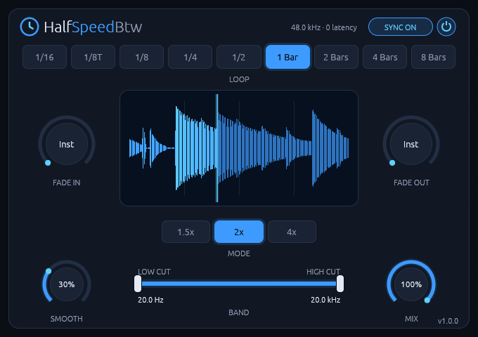

# HalfSpeedBtw

**A tempo-synced half-speed loop effect for Linux, with zero added latency.**
CLAP and VST3 for Linux.



HalfSpeedBtw makes anything sound like it's playing at half speed (or at 1.5x or 4x slower)
while staying locked to your project's tempo. Put it on drums for the classic half-time groove, on
a vocal for a dragged, pitched-down tail, or at short loop lengths for tape-stop and stutter
effects. Automate the power switch to drop it in for a fill or a breakdown.

It runs natively on Linux, with no network access and no telemetry.

**[Read the manual](manual.md)** for every control and how to use it.

## Features

- **Three slowdown modes:** 1.5x, 2x and 4x, with the pitch falling by about a fifth, one octave and two octaves.
- **Nine tempo-synced loop lengths** from 1/16 to 8 bars, locked to the bar grid.
- **Zero latency:** nothing to compensate, no lookahead.
- **Musical fades** for switching it on and off, from instant up to 16 bars.
- **Band and Mix:** filter only the slowed signal, and blend it with the dry one.
- **Live waveform** of the slowed signal across the loop.
- **Cheap:** about 0.2% of one core at 48 kHz in stereo.

## Install

Download the latest version from the [Releases page](https://github.com/rmnhofma/HalfSpeedBtw-release/releases),
or with these commands:

```bash
curl -LO https://github.com/rmnhofma/HalfSpeedBtw-release/releases/download/v1.1.6/HalfSpeedBtw-1.1.6-linux-x86_64.tar.gz
curl -LO https://github.com/rmnhofma/HalfSpeedBtw-release/releases/download/v1.1.6/HalfSpeedBtw-1.1.6-linux-x86_64.tar.gz.sha256
sha256sum -c HalfSpeedBtw-1.1.6-linux-x86_64.tar.gz.sha256 && tar xzf HalfSpeedBtw-1.1.6-linux-x86_64.tar.gz
cd HalfSpeedBtw-1.1.6-linux-x86_64
```

Install for your user:

```bash
mkdir -p ~/.clap ~/.vst3
rm -f ~/.clap/HalfSpeedBtw.clap && cp HalfSpeedBtw.clap ~/.clap/
rm -rf ~/.vst3/HalfSpeedBtw.vst3 && cp -r HalfSpeedBtw.vst3 ~/.vst3/
```

Or for all users:

```bash
sudo mkdir -p /usr/lib/clap /usr/lib/vst3
sudo rm -f /usr/lib/clap/HalfSpeedBtw.clap && sudo cp HalfSpeedBtw.clap /usr/lib/clap/
sudo rm -rf /usr/lib/vst3/HalfSpeedBtw.vst3 && sudo cp -r HalfSpeedBtw.vst3 /usr/lib/vst3/
```

Removing the old copy first avoids overwriting a file a running host has loaded. Then rescan plugins
in your DAW.

To uninstall:

```bash
rm -rf ~/.clap/HalfSpeedBtw.clap ~/.vst3/HalfSpeedBtw.vst3
```

## Requirements

- Linux x86-64 with glibc 2.31 or newer (Ubuntu 20.04, Debian 11, Fedora 32 and newer)
- A CLAP or VST3 host
- X11 or XWayland, and a Vulkan driver for the editor

Releases contain the CLAP and VST3 plugins only.

## License

MIT, see [LICENSE](LICENSE). The licenses of the third-party code in the binaries are in
`THIRD-PARTY-LICENSES.txt` in each release archive.

VST is a registered trademark of Steinberg Media Technologies
GmbH. CLAP is an open standard by the free-audio project. HalfSpeedBtw is an
independent project. It isn't affiliated with or endorsed by Steinberg,
Cableguys (makers of HalfTime) or Cymatics (makers of Dejavu), whose plugins
inspired the effect and its layout.
