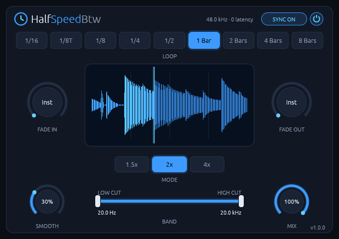
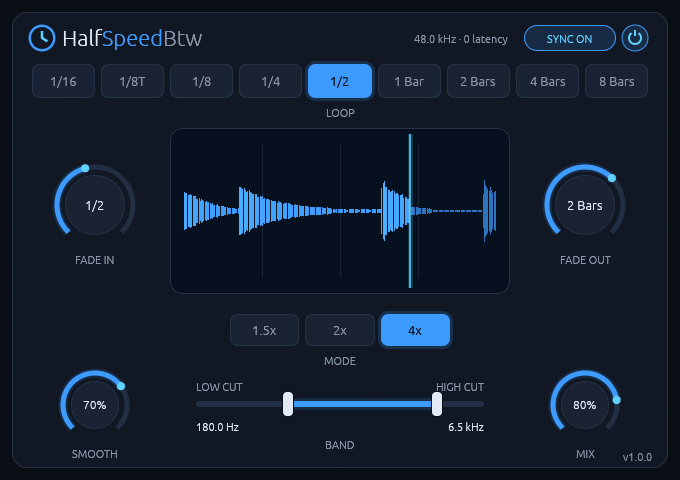

# HalfSpeedBtw manual

**A tempo-synced half-speed loop effect for Linux, with zero added latency.**

Version 1.1.5. To install it, see the [README](README.md).

## Getting started

Put HalfSpeedBtw on a drum track, press play, and you have half-time drums: the defaults are a
1-bar loop at 2x. Then turn the LOOP and MODE knobs to hear what they do.

## The controls

| Control | Range | Default | What it does |
| --- | --- | --- | --- |
| **Power switch** (top right) | On / Off | On | Fades the effect in or out. While it's off, the loop keeps running, so switching it back on lands in time. |
| **Sync** (next to the power switch) | On / Off | On | On: loops follow the host's bar grid while playing. Off: loops free-run at the host tempo. |
| **Loop** | 1/16 to 8 bars | 1 bar | Length of each loop cycle: 1/16, 1/8T, 1/8, 1/4, 1/2, 1, 2, 4 or 8 bars. |
| **Mode** | 1.5x, 2x, 4x | 2x | How much slower the loop plays. |
| **Fade In** | Inst to 16 bars | Inst | How long the effect takes to fade in after you switch it on. |
| **Fade Out** | Inst to 16 bars | Inst | How long it takes to fade out after you switch it off. |
| **Smooth** | 0 to 100% | 30% | Crossfade at each loop restart: 1 ms at 0%, a quarter of the loop at 100%. |
| **Band** | 20 Hz to 20 kHz | Fully open | Low cut and high cut on the slowed signal only (12 dB/octave). At their end stops the filters are off. |
| **Mix** | 0 to 100% | 100% | Dry/wet balance. |

**Mouse:** drag a knob up or down, and hold Shift for fine control. Double-click a knob to
reset it. Every control is also a host parameter you can automate.

Double-click a band handle to reset it too. The version is in the bottom-right corner, and clicking
the logo opens this page.

## How to use it

### What you hear

At the start of each loop cycle, HalfSpeedBtw starts replaying the audio arriving from that moment
on, slower. At 2x, over one cycle you hear the first half of that cycle's audio stretched to fill
the whole cycle. Then the next cycle starts fresh from the present.

It's resampled like slowed-down tape, not time-stretched, so pitch and speed drop together. That's
the character of the effect.

### Loop and Mode

LOOP sets how often it catches up with the present. Long loops sound like the track really runs at
half speed. Short ones (1/16, 1/8) turn into stutters and tape-stop gestures. MODE sets how far
down it goes: 1.5x drops about a fifth, 2x an octave and 4x two octaves.

### Dropping it in for a fill

Automate the **power switch**. The loop keeps running while it's off, so switching it on lands in
time. Set FADE IN and FADE OUT in bars to make it swell in over a build instead of snapping on.

### Smooth

Every loop restart crossfades from the old playback position to the new one. Low SMOOTH keeps
drums tight and punchy. On sustained sounds, raise it to hide the restarts.

### Band and Mix

BAND filters only the slowed signal, so the dry signal keeps its full range. Take the lows out of
the slowed part to keep a bass from getting muddy, or leave a narrow band for a radio-like layer.
Below 100% MIX, the slowed signal sits under the original.

### Sync

With SYNC on and the transport playing, loops restart on the host's bar grid and recover cleanly
when you seek or when the DAW loops back. With the transport stopped, or SYNC off, they free-run at
the host tempo.

## Good to know

- **Latency:** zero. The playback position always trails the input, so it needs no lookahead and
  there's nothing to compensate.
- **Long loops at slow tempos:** up to 40 seconds of lag fit in the buffer, which covers 8 bars of
  4/4 at 4x down to 36 BPM. Below that, playback stops slowing down rather than breaking.
- **Click-free:** every parameter change and loop restart is ramped or crossfaded, and every
  parameter can be automated sample-accurately.
- **Audio:** mono or stereo, at whatever sample rate the host uses.
- **Hosts:** tested in Bitwig Studio. Other CLAP or VST3 hosts should work but haven't been tried.
- **Display:** X11, or XWayland on a Wayland desktop, with a Vulkan driver.

## Troubleshooting

- **It sounds out of sync:** check that Sync is on and the transport is playing. While the
  transport is stopped, loops free-run and aren't tied to the bar grid.
- **The plugin doesn't show up:** check that the bundle is in `~/.clap`, `~/.vst3`,
  `/usr/lib/clap` or `/usr/lib/vst3`, then rescan plugins in your DAW.
- **The editor window stays black or doesn't open:** check that a Vulkan driver is installed.
  The `vulkaninfo` tool from `vulkan-tools` should list your GPU. Bitwig Studio writes plugin
  errors to `~/.BitwigStudio/log/engine.log`.
